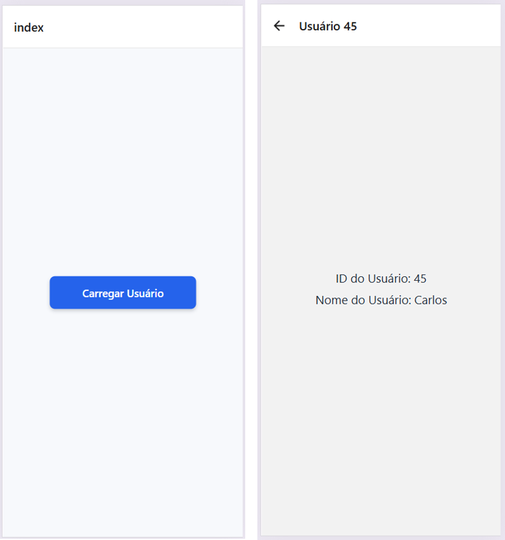

# 10-react-native

# Exercício
Usando a navegação entre telas com passagem de parâmetros dinâmicos de uma tela para outra (com o envio de uma informação (ex: um ID) de uma tela para outra através da rota):

1.	Crie as telas de um aplicativo para consulta de preços e informação complementar dos produtos de uma loja de roupas. Na tela principal, exiba os cards de produtos. Na tela de detalhes, exiba os detalhes do produto escolhido pelo usuário. 

2.	Crie as telas de um aplicativo para consulta de informação sobre os alunos de uma universidade. Na tela principal, exiba os cards dos alunos. Na tela de detalhes, exiba os detalhes sobre o aluno escolhido pelo usuário, como nome completo, matrícula, curso, disciplinas cursadas e a nota final em cada disciplina cursada. 

